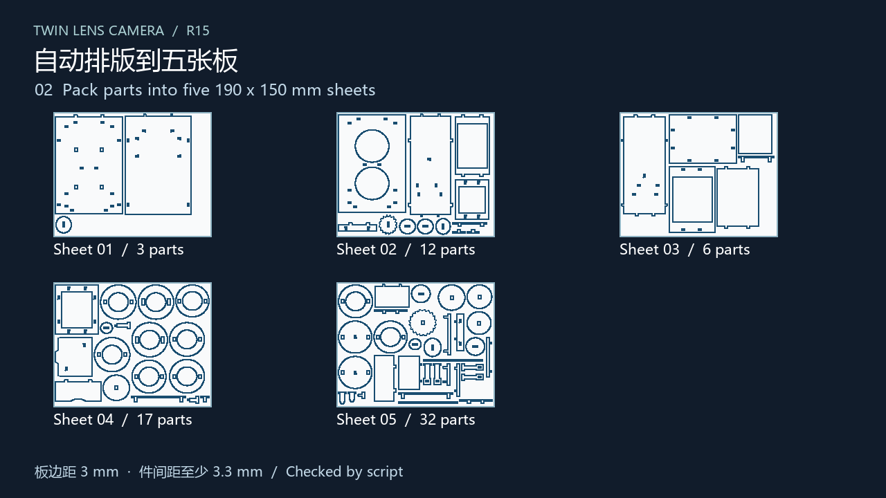
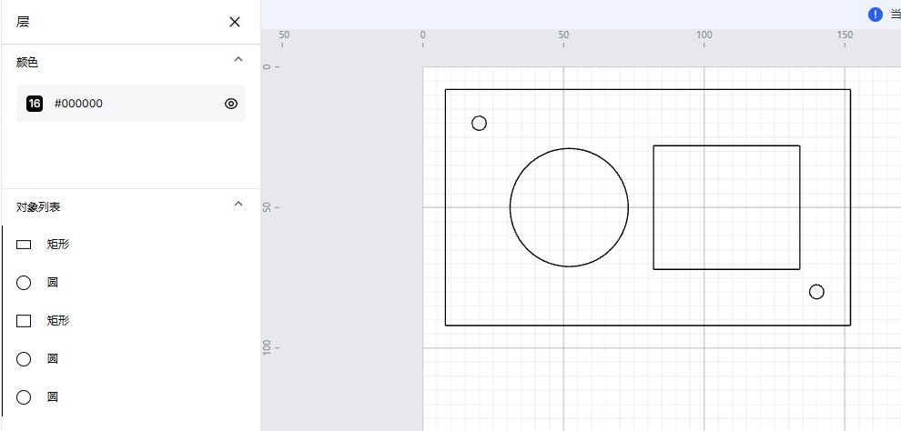
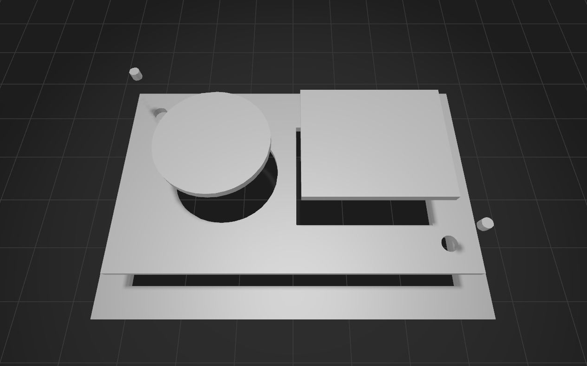

# xTool Studio MCP

本地 MCP 服务，连接 Codex 等客户端与 xTool Studio。可将 DXF 或 SVG 转成 XCS 工程，检查和修订本地工程，以及操作正在运行的 Studio。Windows 桌面功能已在 Studio 1.9.11 验证，macOS 桌面适配仍待实机验证。

A local MCP server that connects Codex and other MCP clients to xTool Studio. Convert DXF or SVG to XCS, inspect and revise saved projects, and work with the running Studio editor. Windows desktop features were tested with Studio 1.9.11. The macOS adapter awaits testing on a Mac.

## 功能演示 · Demo

[观看 19 秒自动排版演示 / Watch the 19-second nesting demo (MP4)](./docs/media/studio-demo.mp4)

演示从 Twin Lens Camera r15 的项目源文件读取轮廓、孔槽和数量，通过独立排版脚本把 70 件零件排到五张 190 × 150 mm 板上。MCP 将每板 SVG 转成 XCS，并在 xTool Studio 中打开第 5 板。演示只使用几何轮廓，原生产文件中的 UV 对位和留桥不属于这次排版输出。

The demo reads contours, cutouts, and quantities from the Twin Lens Camera r15 project source files. A separate script nests 70 parts on five 190 × 150 mm sheets. The MCP server converts each sheet SVG to XCS and opens Sheet 05 in xTool Studio. The demo uses geometry only. Its output omits the original production files’ UV registration and hold tabs.



下方截图另用测试板件展示图层与预览。 / The screenshots below use a separate sample panel to show layers and preview.

| 图层与对象 · Layers and objects | 3D 加工预览 · 3D processing preview |
| --- | --- |
|  |  |

## 安装与连接 · Setup

需要 Windows 或 macOS、Node.js 18+ 和 pnpm。仓库指定 pnpm 10.34.3。使用 DXF 转换时，还需要安装了 `ezdxf` 的 Python。

Requires Windows or macOS, Node.js 18+, and pnpm. The repository pins pnpm 10.34.3. DXF conversion also requires Python with `ezdxf` installed.

在 Windows 上，从项目根目录运行以下 PowerShell 命令。 / On Windows, run these PowerShell commands from the project root.

```powershell
pnpm install --frozen-lockfile
pnpm build

# Optional for DXF conversion
python -m pip install ezdxf

# Register with Codex
$entry = (Resolve-Path '.\packages\stdio\dist\index.js').Path
codex mcp add xtool-studio -- (Get-Command node.exe).Source $entry
codex mcp get xtool-studio
```

在 macOS 上，从项目根目录运行以下命令。 / On macOS, run these commands from the project root.

```sh
pnpm install --frozen-lockfile
pnpm build

# Optional for DXF conversion
python3 -m pip install ezdxf

codex mcp add xtool-studio --env "XTOOL_DXF_PYTHON=$(command -v python3)" -- "$(command -v node)" "$PWD/packages/stdio/dist/index.js"
codex mcp get xtool-studio
```

macOS 上的桌面查询和编辑通过系统辅助功能接口运行。按系统提示，允许启动 MCP 的应用控制「系统事件」，并在「系统设置 → 隐私与安全性 → 辅助功能」授予权限。实时编辑依赖 Studio 公开的控件，找不到目标工程或控件时会返回未确认状态。

On macOS, desktop inspection and editing use the system accessibility interface. If prompted, allow the app hosting the MCP server to control System Events and grant Accessibility access in System Settings under Privacy & Security. Live editing depends on which controls Studio exposes. The server reports when it cannot identify the project or control.

在新的 Codex 会话中使用 `xtool-studio`。其他 MCP 客户端可配置 **stdio**，命令设为 Node.js 可执行文件，唯一参数为 `packages/stdio/dist/index.js` 的绝对路径。如果客户端找不到安装了 `ezdxf` 的 Python，可在客户端的服务环境中设置 `XTOOL_DXF_PYTHON` 指向该解释器。

Use `xtool-studio` in a new Codex session. For other MCP clients, configure **stdio** with the Node.js executable as the command and the absolute path to `packages/stdio/dist/index.js` as its sole argument. If the client cannot find the Python interpreter containing `ezdxf`, set `XTOOL_DXF_PYTHON` in the server environment to that interpreter’s path.

## 常用流程 · Common workflows

- **DXF 或 SVG 转工程。** 用 `studio_convert_dxf_file` 或 `studio_convert_svg_file`，提供源文件和输出文件的绝对路径、机型及加工参数。用 `studio_open_project` 打开生成的 XCS，然后核对尺寸和刀线。
- **在 Studio 中编辑。** 用 `studio_list_editors` 查看工程和选区，选择图层或图形，修改参数，然后预览。已有本地 XS 工程可用 `studio_save_live_project` 保存。
- **另存工程修订。** 先用 `studio_inspect_project` 获取画布 ID 和图形 ID，再将修改写入新的 XS 或 XCS 文件。文件修订工具要求使用新的输出路径。

- **Create a project from DXF or SVG.** Pass absolute input and output paths, the machine model, and processing values to `studio_convert_dxf_file` or `studio_convert_svg_file`. Open the generated XCS with `studio_open_project` and check dimensions and contours.
- **Edit in Studio.** Use `studio_list_editors` to inspect the project and selection. Select a layer or shape, set its parameters, and open the preview. Use `studio_save_live_project` to save an existing local XS project.
- **Write a project revision.** Use `studio_inspect_project` to get canvas and shape IDs, then write edits to a new XS or XCS file. File revision tools require a new output path.

## 工具清单 · Tool reference

### Studio 实时操作 · Live Studio tools

| 工具 / Tool | 中文 | English |
| --- | --- | --- |
| `studio_status` | 查看 Studio 窗口、进程和版本 | Report Studio windows, processes, and versions |
| `studio_list_editors` | 查看工程标签和可读的画布、图层及选区 | List project tabs and available canvas, layer, and selection details |
| `studio_device_status` | 读取 Studio 显示的设备连接状态 | Read the connection indicator shown by Studio |
| `studio_open_project` | 打开 XS 或 XCS 并尝试按完整路径确认标签 | Open XS or XCS and check for a tab matching the full path |
| `studio_select_layer` | 按名称选中图层中的对象 | Select objects on a named layer |
| `studio_select_shape` | 按对象列表中的唯一名称选择 XS 图形 | Select an XS shape by its unique name in the live object list |
| `studio_rename_live_layer` | 重命名前台工程中的图层 | Rename a layer in the foreground project |
| `studio_move_live_shape_to_layer` | 将有唯一名称的 XS 图形移到现有图层 | Move a uniquely named XS shape to an existing layer |
| `studio_set_selection_parameter` | 修改选区的功率、速度或遍数，每次一项 | Set one power, speed, or pass-count field for the selection |
| `studio_save_live_project` | 保存前台本地 XS 并检查磁盘更新 | Save the foreground local XS and check for a disk update |
| `studio_open_preview` | 打开 Studio 加工预览 | Open Studio’s processing preview |

### 本地文件 · Local project files

| 工具 / Tool | 中文 | English |
| --- | --- | --- |
| `studio_convert_dxf_file` | 将平面 DXF 转为 XCS | Convert a planar DXF file to XCS |
| `studio_convert_svg_file` | 将本地 SVG 转为 XCS | Convert a local SVG file to XCS |
| `studio_inspect_project` | 读取 XS v2 或 XCS 的画布、图形及可用参数 | Inspect canvases, shapes, and available settings in XS v2 or XCS |
| `studio_rename_project_layer` | 重命名 XS 图层并另存 | Save an XS revision with a renamed layer |
| `studio_move_shapes_to_layer` | 按 ID 将图形移到现有 XS 颜色层并另存 | Move shapes by ID to an existing XS color layer and save a revision |
| `studio_rename_project_shape` | 按 ID 给 XS 图形命名并另存 | Name an XS shape by ID and save a revision |
| `studio_update_project_settings` | 修改指定激光图形的参数并另存 XS 或 XCS | Update settings for selected laser shapes in an XS or XCS revision |

### 机型、知识库与设计生成 · Machines, knowledge, and design

| 工具 / Tool | 中文 | English |
| --- | --- | --- |
| `list_machines` | 列出机型库中的设备 | List machines in the catalog |
| `get_machine_specs` | 查询机型规格和加工范围 | Read machine specifications and work area |
| `recommend_settings` | 按机型和材料查询加工参数起点 | Find starting settings for a machine and material |
| `search_knowledge` | 搜索 xTool 知识库 | Search the xTool knowledge base |
| `troubleshoot` | 按症状查找可能原因和处理方法 | Find likely causes and fixes for a symptom |
| `generate_test_grid` | 生成 SVG 或 XCS 材料测试网格 | Generate an SVG or XCS material test grid |
| `create_box` | 生成 SVG 或 XCS 指接盒刀路 | Generate SVG or XCS finger-joint box panels |
| `svg_to_xcs` | 将传入的 SVG 文本转为 XCS | Convert inline SVG text to XCS |
| `validate_xcs` | 检查 XCS 文件结构及图形引用 | Check XCS structure and shape references |

## 格式与使用限制 · Formats and limitations

- **DXF。** 读取模型空间的平面刀路。无单位文件需指定 `sourceUnits`，例如 `mm`。曲线默认以 0.02 mm 的展平容差近似为折线。转换将图形移至左上角原点，并为全部轮廓使用一套加工参数。带裁剪的块、标注、文字和填充会导致转换报错。
- **SVG。** 转换要求图形使用毫米坐标。导出前请把缩放、分组变换、引用和裁剪应用到实际刀路。含有无法保真转换的坐标变换或定义的文件会报错。
- **XS / XCS。** Studio 原生工程的读取与修订支持 XS v2。SVG 和 DXF 转换生成 XCS。对 XS 文件按图形修改加工参数时，每个目标图形须对应一项可解析的激光操作。
- **M2。** 转换生成的 M2 XCS 默认使用 10W 蓝光模块。若实际安装了其他模块，请在 Studio 中核对机型和加工设置。
- **实时操作。** 单个图形的实时选择和移动使用对象列表里的唯一 `shapeName`。按 ID 的编辑可用工程文件工具另存修订。辅助功能无法确认设备状态时返回 `unknown`，仅确认已触发按钮时可返回 `invoked`。
- **加工。** 工具可以打开软件预览。加工参数建议是试样起点，使用前应核对机型、材料、尺寸和参数。

- **DXF.** Conversion reads planar model-space contours. For a unitless drawing, specify `sourceUnits`, such as `mm`. Curves are approximated by polylines with a default flattening tolerance of 0.02 mm. Geometry is placed at the upper-left origin, and one operation applies to all contours. Clipped blocks, dimensions, text, and hatches cause a conversion error.
- **SVG.** Conversion expects geometry in millimeter coordinates. Before export, apply scaling, group transforms, references, and clipping to the actual contours. Conversion rejects files containing transforms or definitions it cannot reproduce faithfully.
- **XS / XCS.** Native project inspection and revision support XS v2. SVG and DXF conversion produce XCS. Editing processing settings in an XS file requires one resolvable laser operation per target shape.
- **M2.** Generated M2 XCS projects default to the 10W blue laser module. Check the machine and settings in Studio if another module is installed.
- **Live editing.** Select or move a single shape by its unique `shapeName` in the foreground editor’s object list. Use the file tools to edit by ID in a saved revision. The server can return `unknown` when the device indicator is unavailable and `invoked` when only the button action was confirmed.
- **Processing.** The tools can open the software preview. Recommended settings are starting points for material tests. Check the machine, material, dimensions, and settings before processing.

## 开发与来源 · Development and attribution

```powershell
pnpm build
pnpm typecheck
pnpm test
pnpm start:stdio
```

本项目基于上游项目的机型知识库、工程生成器、MCP 资源及提示词，保留原有 MIT 许可和 Git 历史。仓库也保留上游 Cloudflare Worker 的源码，Studio 桌面工具通过本地 stdio 服务使用。

This project builds on the upstream machine knowledge base, project generators, MCP resources, and prompts. It retains the original MIT license and Git history. The repository also contains the upstream Cloudflare Worker source. Studio desktop tools run through the local stdio server.

[上游项目 / Upstream project](https://github.com/iamcoyr/xtool-mcp) · [架构 / Architecture](./docs/architecture.md) · [XCS 格式 / XCS format](./docs/xcs-format.md) · [贡献 / Contributing](./CONTRIBUTING.md) · [使用说明 / Disclaimer](./DISCLAIMER.md) · [MIT 许可 / License](./LICENSE)

## 相比上游的改动 · Changes from upstream

对比基准为上游 `iamcoyr/xtool-mcp` 的 `main` 分支提交 `f3195c9`。 / The comparison uses commit `f3195c9` on the upstream `iamcoyr/xtool-mcp` `main` branch.

### 新增功能 · Added

| 中文 | English |
| --- | --- |
| **Studio 桌面控制。** 本地 MCP 可打开 XS/XCS、查看工程与设备状态、选择图层或对象、修改加工参数、保存本地 XS 和打开加工预览。加入 Windows 和 macOS 适配器。Windows 已在 Studio 1.9.11 实测，macOS 待实机验证。 | **Studio desktop control.** The local MCP server opens XS/XCS files, reads project and device status, selects layers or objects, edits processing settings, saves local XS projects, and opens the processing preview. Windows was tested on Studio 1.9.11. The macOS adapter awaits testing on a Mac. |
| **本地文件转换。** 新增平面 DXF 转 XCS，支持为无单位 DXF 指定源单位。新增直接读取本地 SVG 并保存为 XCS 的工具。 | **Local file conversion.** Convert planar DXF files to XCS with an explicit source unit for unitless drawings. A local SVG file can also be converted directly to XCS. |
| **工程检查与另存修订。** 读取 XS v2 和 XCS 的画布、图形及加工参数。支持另存加工参数修订，以及在 XS 中改名或移动图形到已有颜色层。 | **Project inspection and revisions.** Read canvases, shapes, and processing settings in XS v2 and XCS. Save processing revisions to a new file, or rename layers and shapes and move shapes between existing color layers in XS. |
| **xTool M2。** 新增机型条目及 XCS 生成支持，默认使用 10W 蓝光模块。 | **xTool M2.** Added a machine entry and XCS generation support with the 10W blue laser module as the default. |

### 修复与加固 · Fixes and safeguards

| 中文 | English |
| --- | --- |
| **SVG 路径保真。** 修正相对路径、贝塞尔曲线和圆弧的包围盒计算，保留开放路径，并忽略注释里的图形。遇到无法准确转换的缩放、变换或元素时明确报错，避免静默生成错误刀线。 | **SVG path fidelity.** Corrected bounds for relative commands, Bézier curves, and arcs, preserved open paths, and ignored commented-out geometry. Unsupported scaling, transforms, and elements now produce explicit errors. |
| **多画布 XCS 校验。** 在各自画布内匹配图形与加工参数，报告引用缺失或跨画布错配。遇到空文档或无效图形条目时返回结构化错误。 | **Multi-canvas XCS validation.** Match shapes and processing settings within each canvas, report missing or mismatched references, and return structured errors for null documents or invalid shape entries. |
